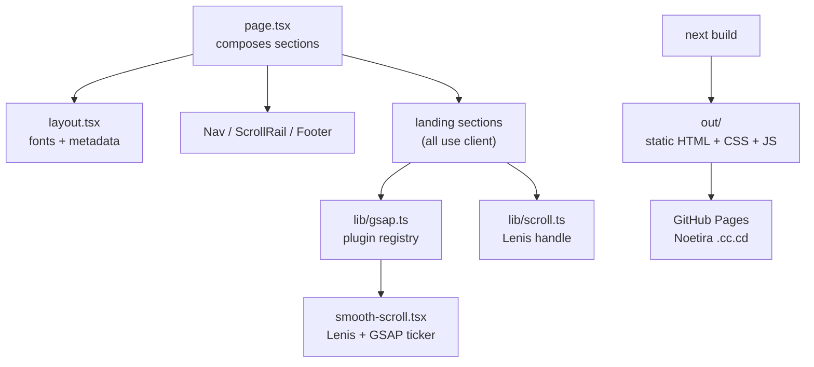

# Noetira 

> **One shared picture of your company.**
> A single, trustworthy description of how a business fits together — the things it runs on, how they relate, and what people and AI tools are allowed to do with them. Every answer is grounded, every change is checked, and everything is written down.

This repository is the **Noetira  website**: a fully static, zero-backend, fully open-source marketing site. It deploys as plain HTML/CSS/JS to GitHub Pages at **[Noetira .cc.cd](https://Noetira .cc.cd)**.

The product itself ships separately. This repo is deliberately scoped to the front door, and the front door links people to the source:

**<https://github.com/Debronejacobs/Noetira Main>**

There is no paid tier, no "open core", no early-access list and no email capture. Noetira  is free and open source.

---

## Table of contents

- [What this is](#what-this-is)
- [Architecture at a glance](#architecture-at-a-glance)
- [Tech stack](#tech-stack)
- [Getting started](#getting-started)
- [Project structure](#project-structure)
- [The landing page](#the-landing-page)
- [Animation system](#animation-system)
- [Static export & deployment](#static-export--deployment)
- [Writing copy](#writing-copy)
- [Conventions](#conventions)
- [Notes & caveats](#notes--caveats)

---

## What this is

Noetira  is an **open-source, self-hosted "company kernel"**: one secure front door through which every person and every AI tool reaches the business. This app is the public front door for that product — a single-page, scroll-driven experience composed of independent section components, wrapped in a global smooth-scroll and motion layer.

**There is no server.** No API routes, no database, no Prisma, no auth. Every section is a client component; the only server-rendered file is `src/app/layout.tsx`, which contributes `<head>` metadata and font wiring at build time. The build output is a directory of static files.

The narrative arc, in render order (`src/app/page.tsx`):

1. **Hero** — positioning, plus a live "reviewable diff" panel and a GitHub icon
2. **Trust marquee** — logos of the platforms Noetira  connects to
3. **Problem** — the fragmentation story
4. **Ontology** — the things, how they relate, and what may be done
5. **Endpoint** — one door in, one log out
6. **Deployment** — connect → review the draft → govern and act
7. **Guarded CRUD** — changes pass the safety checks
8. **Tuesday** — a day-in-the-life scenario
9. **Design principles** — the deliberate choices behind the product
10. **Comparison** — positioning against alternatives
11. **Roadmap** — staged delivery
12. **FAQ** — the recurring objections
13. **FinalCta** — the single call to action: go to the source

---

## Architecture at a glance



Everything below `Sections` runs in the browser. The build step is a pure transform; nothing executes per request.

---

## Tech stack

| Layer | Choice |
| --- | --- |
| Framework | Next.js 16 (App Router, `output: "export"`) |
| UI | React 19 |
| Language | TypeScript 5 (strict) |
| Styling | Tailwind CSS v4 + `tw-animate-css` |
| Primitives | shadcn/ui (New York), Radix UI, `class-variance-authority`, `clsx`, `tailwind-merge` |
| Motion | GSAP 3 (ScrollTrigger, SplitText, DrawSVGPlugin) + Lenis |
| Icons | `lucide-react` |
| Fonts | `next/font/google` — Inter, Space Grotesk, JetBrains Mono, Instrument Serif |
| Package manager | Bun |
| Deploy | GitHub Actions → GitHub Pages |

---

## Getting started

Requires **Bun** (or Node 20+ with an equivalent package manager) — the lockfile is `bun.lock`.

```bash
bun install
bun run dev        # http://localhost:3000
```

### Scripts

| Script | What it does |
| --- | --- |
| `bun run dev` | Dev server on port 3000 |
| `bun run build` | Static export to `out/` |
| `bun run typecheck` | `tsc --noEmit` |
| `bun run lint` | ESLint |

There is no `start` script — nothing to run. Serve the build with any static file server if you want to preview the real artifact:

```bash
bun run build && bunx serve out
```

### Environment

**No environment variables are required, and there is no `.env` file in the repo.** The site has no database and no server-side secrets. If you find a stale `.env` locally from an older checkout, it is safe to delete.

---

## Project structure

```
Noetira /
├── .github/workflows/
│   └── deploy-pages.yml        # typecheck → build → deploy to Pages
├── public/
│   ├── .nojekyll               # required: stops Jekyll eating _next/
│   ├── CNAME                   # Noetira .cc.cd
│   ├── logo.svg
│   └── robots.txt
├── src/
│   ├── app/
│   │   ├── globals.css         # theme tokens, grid/noise overlays, keyframes
│   │   ├── layout.tsx          # fonts, metadata, SmoothScroll, Toaster
│   │   └── page.tsx            # composition of all sections
│   ├── components/
│   │   ├── landing/            # section + motion components
│   │   └── ui/                 # shadcn primitives
│   ├── hooks/                  # use-mobile, use-toast
│   └── lib/
│       ├── gsap.ts             # plugin registration, prefersReducedMotion
│       ├── scroll.ts           # Lenis instance registry, scrollToId
│       └── utils.ts            # cn()
├── next.config.ts              # output: "export"
├── tailwind.config.ts
├── components.json             # shadcn config
└── tsconfig.json               # @/* → src/*
```

Anything you might expect and won't find — `src/app/api/`, `src/lib/db.ts`, `prisma/`, `db/`, `Caddyfile`, `.zscripts/`, `mini-services/`, `tests/` — was removed when the site became static. Do not reintroduce them here.

---

## The landing page

`src/app/page.tsx` is a flat composition with no logic of its own. Every section is self-contained: it owns its copy, its animation, and its reduced-motion fallback.

| Component | Section id |
| --- | --- |
| `Hero` | `top` |
| `TrustMarquee` | — |
| `Problem` | `problem` |
| `Ontology` | `product` |
| `Endpoint` | `endpoint` |
| `Deployment` | `deployment` |
| `GuardedCrud` | `writes` |
| `Tuesday` | `scenario` |
| `DesignChoices` | `choices` |
| `Comparison` | `compare` |
| `Roadmap` | `roadmap` |
| `Faq` | `faq` |
| `FinalCta` | `source` |

`scroll-rail.tsx`'s `SECTIONS` list must stay in sync with these ids — it drives the fixed right-edge progress rail and its active-dot highlighting. `nav.tsx`'s `LINKS` is a shorter list of the sections worth jumping to, and intentionally does not include `#source`.

### Shared primitives

- **`SectionHeading`** — eyebrow + split-line heading + optional lead. The most-used typographic primitive.
- **`Reveal` / `RevealGroup`** — fade-up on scroll. Initial state is set by GSAP, so content stays visible without JS.
- **`AnimText`** — SplitText-based `chars` / `words` / `lines` animation.
- **`Magnetic`** — pointer-fine hover lean, disabled for reduced motion and touch.

### Links

Two places own a destination:

1. `GITHUB_URL` — declared as a local constant in `hero.tsx`, `nav.tsx`, `footer.tsx` and `final-cta.tsx`. All four point at `https://github.com/Debronejacobs/Noetira Main`. If the repository moves, update all four.
2. `CONTACT_EMAIL` — declared in `final-cta.tsx`. Nothing else owns a contact address.

The hero's only call to action is a **bare GitHub icon** — an `<a>` wrapping `<Github />`, not a `Button`. Keep it that way; there is no primary CTA button.

---

## Animation system

Two files carry the whole motion layer:

**`src/lib/gsap.ts`** registers `ScrollTrigger`, `SplitText`, and `DrawSVGPlugin` once, on the client only, and exports two guards:

```ts
prefersReducedMotion() // matchMedia("(prefers-reduced-motion: reduce)")
isDesktop()            // matchMedia("(min-width: 1024px)")
```

**`src/components/landing/smooth-scroll.tsx`** creates the Lenis instance, exposes it to `gsap.ticker`, and re-triggers `ScrollTrigger.refresh()` on load and after fonts settle. It is a no-op under reduced motion, leaving native scrolling intact.

`src/lib/scroll.ts` holds the instance so `scrollToId()` works with or without Lenis:

```ts
scrollToId("#product"); // Lenis smooth scroll, or scrollIntoView fallback
```

### Rules the codebase follows

- **Every animation checks `prefersReducedMotion()` first** and returns early. Content must be readable with no JS at all.
- **Animations live in `useEffect` inside `gsap.context()`** and are reverted on cleanup.
- **Never animate on mount for above-the-fold text that is also SEO-relevant** — `AnimText` handles this by leaving text in the DOM.
- **`ScrollTrigger` needs a refresh after layout shifts.** The loader handles fonts; if you add an image or a late-mounting block, call `ScrollTrigger.refresh()` yourself.

---

## Static export & deployment

`next.config.ts` sets `output: "export"`, `trailingSlash: true`, `images.unoptimized: true`, `typescript.ignoreBuildErrors: false`, and pins `turbopack.root`. The build writes `out/`, which is exactly what GitHub Pages serves.

### Deployment

`.github/workflows/deploy-pages.yml` runs on every push to `main`:

1. `bun install --frozen-lockfile`
2. `bun run typecheck`
3. `bun run build`
4. upload `out/` → deploy to Pages

Enable it once in the repository settings: **Settings → Pages → Source: GitHub Actions**.

### Domain

`public/CNAME` contains `Noetira .cc.cd`. Because the site is served from a custom domain at the apex of its own host, **no `basePath` or `assetPrefix` is needed** — every asset resolves from `/`. Point a `CNAME` DNS record for `Noetira .cc.cd` at `<user>.github.io`. If you ever move to `username.github.io/Noetira /`, you must set both `basePath` and `assetPrefix`.

### The `.nojekyll` trap

GitHub Pages runs Jekyll by default, which ignores directories beginning with an underscore. `_next/` is exactly that, so without `public/.nojekyll` the deployed site loads with no CSS or JS. The file is committed *and* re-touched in the workflow before upload.

### Local preview of the real artifact

```bash
bun run build
bunx serve out
```

This is the closest local analogue to production. `bun run dev` exercises the dev server, not the export path.

### Build-time network

`next/font/google` fetches font files at build time. GitHub Actions has network access so this is fine; an offline build will fail on fonts. To make the build hermetic, self-host the four families in `public/fonts/` and switch to `next/font/local`.

---

## Writing copy

The audience is **non-technical**. Copy should read like a clear explanation to a smart colleague who does not work in software.

**Avoid:** ontology, CRUD, MCP, lineage, guardrail, RBAC, typed action, dry run, append-only, PII, and similar terms. Plain alternatives usually exist — "the things you work with", "how they relate", "what is allowed", "check before it happens".

**Keep:** real product names (PostgreSQL, Snowflake, Salesforce). They are recognition signals, not jargon.

**Positioning is fixed:** Noetira  is fully open source. Never describe a paid tier, a "full version", an "open core", a licence purchase, or an early-access list. The only action offered to a visitor is "go to the source".

---

## Conventions

- **`"use client"` on every section.** Anything using GSAP, Lenis, `window`, or local state needs it. The only server component is `layout.tsx`.
- **No new dependencies for motion.** GSAP and Lenis are already the chosen tools; reach for them before adding another animation library.
- **Tailwind utilities only.** Theme colours live as CSS variables in `globals.css` (`bg-paper`, `text-ink`, `text-moss`, `bg-night`, …). Don't hardcode hex values in components.
- **`cn()` for conditional classes.** Never concatenate class strings manually.
- **shadcn primitives are vendored** in `src/components/ui/`. Edit them in place; they are not upstream-synced.
- **Accessibility is a correctness requirement.** Interactive controls need labels, focus is visible, and every motion path respects reduced motion.

---

## Notes & caveats

- **`typescript.ignoreBuildErrors` is `false`.** The build fails on type errors — this is intentional and is what makes the CI typecheck gate meaningful.
- **`next.config.ts` pins `turbopack.root`.** Without it, Next walks up and finds an unrelated lockfile above the project, warning about the wrong workspace root.
- **`scripts/gen_brand_module.py` and `scripts/fetch_logos.py`** are one-shot generators for `brand-logos.tsx`. They read from `/tmp` and are not part of the build. Keep them only if you intend to regenerate brand marks.
- **Some shadcn primitives in `src/components/ui/` are unused.** They came with the scaffold; there is no tree-shaking cost beyond bundle size, and pruning them is optional.
- **`@vercel/turbopack-next/internal/font/google/font` errors** are a stale-cache symptom. `rm -rf .next node_modules/.cache && bun install` resolves them.